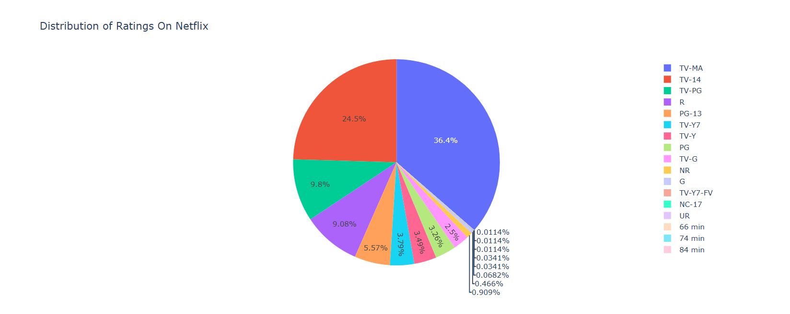
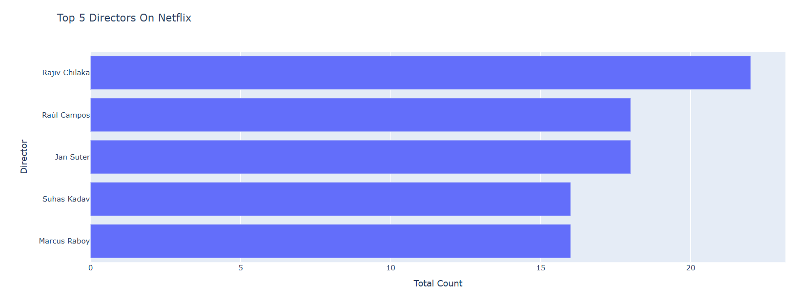
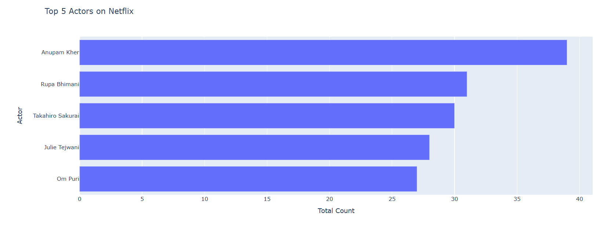
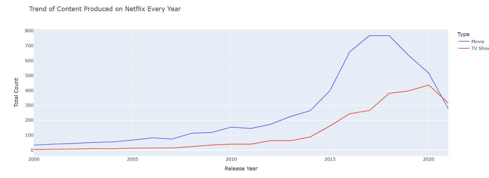
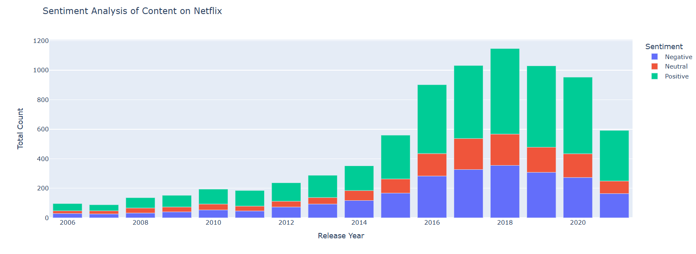

# 🎬 Netflix Content & Sentiment Data Analysis using Python

## 📌 Project Overview
This project performs an end-to-end Exploratory Data Analysis (EDA) and Sentiment Analysis on the Netflix Movies and TV Shows dataset. The primary objective is to analyze global content trends, content rating distributions, top actors/directors, and perform natural language sentiment analysis on title descriptions using Python.

---

## 📁 Project Repository Files & Dataset
* **Python Code File (Google Colab / Jupyter):** [Netflix Data Analysis.ipynb](Netflix%20Data%20Analysis.ipynb)
* **Dataset File:** [netflix_titles.csv](netflix_titles.csv)

---

## 🛠️ Tech Stack & Libraries Used
* **Python** (Core Language)
* **Pandas** (Data Cleaning, Manipulation & Preprocessing)
* **NumPy** (Numerical Computations)
* **Plotly Express / Matplotlib / Seaborn** (Interactive Data Visualizations)
* **TextBlob** (Natural Language Processing for Sentiment Analysis)
* **Google Colab** (Execution Environment)

---

## 📊 Key Insights & Visualizations

### 1. Content Rating Distribution
Analyzed the rating spectrum across the platform to understand target audience distributions (e.g., TV-MA, TV-14).


### 2. Top 5 Directors & Actors on Netflix
Identified the most frequent directors and cast members based on overall content contribution.
* **Top Directors:**

* **Top Actors:**


### 3. Content Production Trend Over the Years
Tracked the growth and trend of Movies vs. TV Shows added to Netflix over time.


### 4. Description Sentiment Analysis
Leveraged `TextBlob` to classify content descriptions into Positive, Neutral, and Negative sentiments across release years.


---

## 📈 Major Business Takeaways
1. **Audience Targeting:** A significant portion of Netflix's catalog falls under `TV-MA` (Mature Audience) and `TV-14`, indicating a heavy focus on young adults and mature viewers.
2. **Content Format:** Movies historically outnumber TV Shows, but TV Show additions have seen steady growth over recent years.
3. **Sentiment Strategy:** Overwhelmingly, content descriptions lean towards positive or neutral sentiment, aligning with audience engagement strategies.

---

## 🚀 How to Run
1. Clone this repository:
   ```bash
   git clone https://github.com/Rajkumar-521/Netflix-Data-Analysis-Python.git
